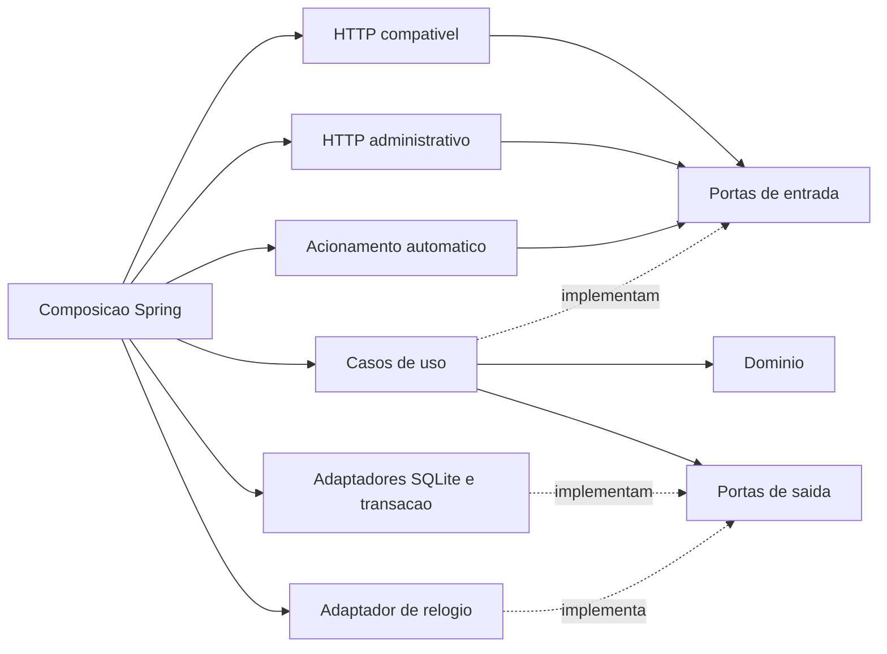
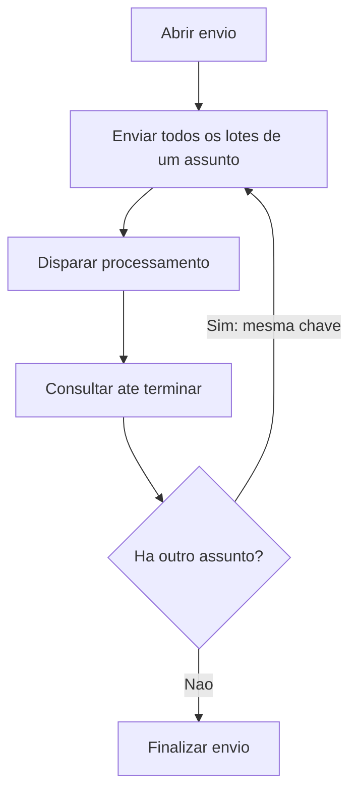

# Arquitetura do simulador e-Sfinge Tributário

Decisões adotadas em 23/10/2026. **Guia de implementação futura; E0 concluído documentalmente no recorte inicial.**
O repositório contém documentação, sem aplicação, build, testes ou imagem Docker.

## 1. Autoridade e fronteira

O [planejamento](docs/planejamento-simulador-tributario.md) define escopo,
invariantes, etapas E0–E4 e aceite T01–T19. O [contrato E0](docs/contrato-e0.md)
consolida o inventário relatado, escolhas do simulador e lacunas HTTP. Este
documento define a stack e as fronteiras técnicas adotadas para implementá-los.
Decisão arquitetural não encerra pendência de contrato nem comprova compatibilidade.

O simulador começa na entrada HTTP que substitui o TCE. Recebe os lotes produzidos
pelo integrador, sem capturar dados da origem, transformar registros ou montar
lotes em seu lugar. Funciona sem encaminhar chamadas ao TCE. O executor de testes
prepara cenários por uma interface administrativa independente do integrador.

Perfil selecionado pelo usuário: **2026 / V6 / leiaute 6.06**, ainda sem validação
independente do cliente. CONs 6.9 são referência proposta. A prioridade inicial é
estrutura, sequência, conteúdo e contagens nos seis assuntos; validação de
vínculos de negócio e regras tributárias permanece como evolução.

### Diferenças para a documentação anterior

- A stack do simulador deixa de ser proposta e passa a ser decisão adotada aqui.
  O integrador foi confirmado por relato como Spring Boot 3.5.10 na consolidação
  E0; isso não fixa a versão corretiva do futuro build do simulador.
- A proposta de diretório de payloads da seção 6 do planejamento é substituída
  por armazenamento dos bytes no próprio SQLite, junto dos metadados.
- Instância e volume local por execução em Docker Linux amd64 são o padrão
  confirmado. arm64 e uso compartilhado ficam fora da operação inicial.
- A premissa antiga de um assunto por remessa já foi retirada do planejamento
  atual. O contrato derivado define uma UG/competência por envio e chave retornada
  pela abertura; comprovação independente pelo cliente permanece futura.

O contrato E0 está presente nesta revisão; a ausência observada durante a
elaboração do plano não corresponde mais ao estado do repositório. Este trabalho
não reescreve o planejamento nem reconstrói o contrato.

## 2. Stack adotada

| Área | Escolha | Diretriz |
|---|---|---|
| Linguagem/runtime | Java 21 | Domínio e aplicação em Java puro |
| Aplicação e HTTP | Spring Boot 3.5 e Spring MVC | Spring restrito aos adaptadores e à composição |
| Build | Maven, um módulo | Fixar versões exatas no build futuro; sem versões dinâmicas |
| JSON e estrutura | Jackson e Bean Validation | Contrato externo validado e mapeado na fronteira |
| Persistência | SQLite, SQLite JDBC e Spring JDBC com `JdbcTemplate` | SQL explícito e parametrizado; sem ORM |
| Testes | JUnit 5 | Núcleo isolado; adaptadores testados com implementações reais |
| Distribuição | Docker e volume local | Uma instância por execução local/CI |

Não adicionar Kafka, Redis, microsserviços, ORM ou portal administrativo ao
recorte inicial. O simulador não compartilha classes ou dependências internas do
integrador. Versões corretivas e comandos serão registrados no build quando ele
existir; este guia não apresenta comandos de aplicação ainda inexistentes.

## 3. Arquitetura hexagonal: portas e adaptadores

Um monólito modular, organizado por capacidade: autenticação, remessas/lotes,
processamento, cenários e evidências. São fronteiras de responsabilidade dentro
de um único contexto, não serviços distribuídos nem novos contextos de domínio.

| Área | Responsabilidade e dependências permitidas |
|---|---|
| Domínio | Entidades, valores, invariantes e transições; somente Java e domínio pertinente |
| Aplicação | Casos de uso; depende do domínio e de portas do núcleo |
| Portas de entrada | Contratos dos casos de uso, comandos e resultados independentes de transporte |
| Portas de saída | Necessidades do núcleo: persistência, relógio e execução transacional |
| Adaptadores de entrada | HTTP compatível, HTTP administrativo e acionamento automático; invocam portas de entrada |
| Adaptadores de saída | SQLite/JDBC, transações e relógio; implementam portas de saída |
| Configuração | Composição de objetos e configuração Spring/operacional |

As setas abaixo representam **dependências de código**, não fluxo de dados.



Domínio e aplicação não importam Spring, JDBC, Jackson, Bean Validation ou tipos
HTTP. Anotações de serialização, validação e transação ficam nos adaptadores.
Pré-condições e invariantes continuam verificadas pelo núcleo, inclusive quando
a entrada vier do controle administrativo ou de testes sem HTTP.

### Pacotes e comunicação entre capacidades

Árvore ilustrativa sob o pacote-base da aplicação; não criar diretórios vazios:

```text
<pacote-base>/
  autenticacao/
  remessas/
    domain/
    application/
      port/in/
      port/out/
    adapter/
      in/http/
      out/jdbc/
  processamento/
    domain/
    application/
      port/in/
      port/out/
    adapter/in/scheduler/
    adapter/out/jdbc/
  cenarios/
  evidencias/
  configuration/
```

Aplicar a mesma separação às demais capacidades conforme surgirem classes.
Portas pertencem ao núcleo consumidor; adaptadores não definem contratos que o
núcleo precise importar. Uma capacidade usa as portas públicas de outra, sem
acessar seus adaptadores ou tabelas diretamente. Evitar dependências circulares;
operações coordenadas ficam no caso de uso responsável pelo fluxo.

Interfaces representam fronteiras substituíveis reais. Não exigir interface para
cada classe, repositório CRUD genérico, hierarquia de serviços ou barramento de
eventos. Compartilhar somente conceitos necessários, sem pacote genérico de
utilidades para contornar as fronteiras.

DTOs HTTP, objetos do núcleo e representações JDBC são distintos, com mapeamento
explícito nos adaptadores. Comandos e resultados das portas contêm tipos Java e
conceitos do caso de uso; não carregam `ResponseEntity`, `JsonNode` ou `ResultSet`.
Os bytes originais acompanham a recepção sem depender da representação JSON
desserializada. Fases internas são traduzidas para respostas externas somente
quando o contrato dessa tradução estiver definido.

### Transações sem Spring no núcleo

A aplicação define a unidade atômica da operação por uma porta de execução
transacional: executa uma ação e recebe seu resultado, sem conhecer conexão ou
gerenciador Spring. O adaptador implementa essa porta com o gerenciamento de
transações JDBC do Spring. Todos os acessos JDBC daquela unidade usam o mesmo
`DataSource` e a mesma conexão transacional.

Composição é responsabilidade de `configuration`; o domínio não abre transações.
Persistir payload, vínculos, mudança de estado e evento correspondente deve
concluir ou falhar em conjunto. Quando houver trabalho persistido, seu vínculo e
elegibilidade entram na mesma unidade. Na recepção ele não fica executável antes
do disparo explícito. A atomicidade interna não constitui garantia oficial do TCE
sobre aceitação por registro ou lote.

## 4. Modelo de domínio de implementação

As responsabilidades abaixo derivam do planejamento e do contrato E0. Não
estabelecem schemas HTTP, nomes de tabelas ou enums externos.

| Conceito | Responsabilidade |
|---|---|
| Cenário/execução | Identifica perfil, seed, tempo inicial, falhas e geração de reset |
| UG e usuário | Identidade fictícia, vínculo e autorização local; cliente seleciona uma UG por envio, sem inferir igualdade entre seus códigos |
| Competência | UG, ano/mês e bloqueio controlado pelo cenário |
| Remessa/envio | Agrupa lotes sob chave opaca retornada pela abertura, uma UG e competência, conforme relato consolidado |
| Assunto | Categoria dos registros; cada lote contém um assunto e o fluxo relatado reutiliza a chave entre assuntos |
| Lote | Número/ID, ordem de chegada, assunto, vínculos, payload/hash, contagens e resultado |
| Trabalho | Unidade persistida de processamento/expiração, com agendamento, ordem, condição e geração |
| Resultado | Registra o que foi processado, erros e efeitos; deriva dos dados e das regras executadas |
| Evento | Evidência sanitizada de chamada, transição ou recuperação, com correlação e instante |

Preservar as distinções:

- **Recebidos:** conteúdos aceitos na recepção, com localização no payload.
- **Processados:** conteúdos examinados, com resultado e regras aplicadas.
- **Efetivos:** dados que continuam válidos no cenário após processamento e
  recuperação; sua publicação segue o contrato derivado, sem inferir validação fiscal.
- **Históricos:** controles e eventos preservados após descarte; não são dados
  ativos nem duplicatas de um novo envio.

Os seis assuntos são cadastro de contribuinte, lançamento de crédito, diário de
arrecadação, baixa de crédito, saldo inicial e início do prazo prescricional.
Conservar as referências recebidas entre eles. Sua validação de negócio está
adiada; isso não dispensa integridade interna lote/remessa/UG/cenário.

## 5. Fluxo, persistência e processamento

### Entrada e confirmação

Fluxo confirmado por relato e consolidado no contrato derivado em 23/10, sem execução independente do cliente:



1. O adaptador HTTP conserva bytes originais, decodifica e valida o contrato,
   autentica por porta do núcleo e mapeia a requisição para o caso de uso.
2. O caso de uso confere autorização sobre UG/cenário, estado e sequência,
   inclusive vínculos de chave e lote. Token válido não autoriza outra UG.
3. Pela porta transacional, persiste bytes, hash, vínculos, contagens de recepção
   e evidência. Responde confirmando recebimento somente após commit.
4. Receber ou consultar não inicia processamento. Disparo explícito agenda
   trabalhos elegíveis; o executor aplica as transições e efeitos.

Falha antes do commit não confirma a operação. Na falha selecionada de resposta
perdida após aceitação, o commit permanece, o lote fica em `RECEBIDO` e somente a
resposta se perde. Decisão de falha vem do cenário; seu efeito de transporte é
aplicado no adaptador, sem instruções de teste no payload compatível.

### Executor, relógio e retomada

Um executor processa trabalhos persistidos por instância. O modo automático
aciona a porta de processamento quando houver trabalho devido; o manual usa a
mesma porta pelo controle administrativo. Agendador não decide estados nem
executa SQL. Serializar acionamentos manuais e automáticos para evitar execução
simultânea do mesmo trabalho.

Tempo de negócio vem da porta de relógio. No modo manual, somente comandos
explícitos avançam o tempo; não usar espera real para testar expiração. Ordenar
trabalhos por instante agendado e sequência persistida de desempate. Mesmas
entradas, seed e comandos devem produzir o mesmo resultado lógico.

Usar transações curtas; não manter transação durante espera de transporte ou
latência simulada. Se cálculo ocorrer fora dela, revalidar estado, elegibilidade
e geração na transação que grava o resultado. Gravar efeitos e conclusão do
trabalho atomicamente. Reinício retoma trabalhos não concluídos sem reaplicar
efeitos já confirmados; testar interrupção antes e depois do commit. Essa
proteção interna não define idempotência de chamadas HTTP.

Reset muda a geração de forma atômica e invalida trabalhos anteriores. Toda
gravação de efeitos verifica a geração atual dentro da mesma transação; trabalho
antigo não altera o cenário novo. Distinguir reinício do processo, que conserva
estado, de reset administrativo, que recria a execução.

### SQLite e fidelidade de conteúdo

Guardar payloads originais como bytes no SQLite, na mesma base dos metadados,
resultados, eventos e fila. Hash identifica conteúdo para rastreabilidade, sem
deduplicação automática ou promessa de idempotência.

Habilitar chaves estrangeiras em cada conexão e usar restrições para vínculos
internos e invariantes já definidos. Tratar contenção e falhas de banco
explicitamente; nunca converter falha de persistência em sucesso. Consultas
filtram também por UG, cenário e geração pertinentes. Uma chave externa isolada
não é autorização.

Valores monetários usam `BigDecimal`, construído a partir de representação exata,
e texto decimal no SQLite; não usar `double`, `float`, `REAL` ou agregação SQL que
converta para ponto flutuante. Escala, arredondamento e formato externo seguem
o contrato, sem normalização arbitrária. Identificadores mantêm tipos e zeros;
não transformar toda chave em número. Contagens derivam de registros e efeitos,
distinguindo recebidos, processados, descartados e efetivos.

Evoluir o schema com scripts SQL versionados e registro da versão aplicada.
Reinício não recria silenciosamente a base; schema incompatível produz erro
explícito. Reset de cenário é caso de uso, não substituto de migração.

### Recuperação selecionada

Aplicar as [decisões do contrato E0](docs/contrato-e0.md#comportamentos-selecionados):

- Lote com erro é descartado; seguintes ainda não processados **do mesmo assunto**
  são abortados. Anteriores válidos permanecem até descarte explícito.
- Descarte por assunto remove seus dados no envio aberto, inclusive pendentes,
  preservando demais assuntos, a chave e controles históricos.
- Após resposta perdida, nova tentativa daquele assunto retorna erro de envio
  aberto com lotes sem processamento. Recuperação: descartar assunto e reenviar
  sob a mesma chave; sem reconhecimento por hash.
- Cancelamento integral remove recebidos/processados/efetivos do envio atual,
  invalida trabalhos, exige nova chave e reenvio completo; preserva controles
  históricos e remessas anteriores. Revalidar chave aberta ao gravar efeitos.

`cancelamentoAutomatico=NAO` é texto na query; omissão/outros valores recebem
422, fora do aceite inicial. Descarte durante processamento é 409. Finalização
usa lotes ativos concluídos e totais efetivos; histórico não bloqueia. Disparos
ativos/sem elegíveis e repetições inválidas retornam 409 sem efeitos; lotes vazios
são rejeitados. Sem movimento e contagem mensal T17 ficam para evolução.
O contrato E0 define os envelopes e a recuperação aproximada de RECEBIDO.

## 6. Práticas para agentes

- Controllers tratam transporte e mapeamento de erro; aplicação coordena;
  domínio decide; adaptadores executam acesso externo. Usar injeção por construtor.
- Validar tipos, formatos, obrigatórios e ausente versus `null` pelos schemas
  derivados do contrato. Opcionais admitem ausência/null; extras são rejeitados
  no modo estrito. Condições tributárias ficam não implementadas, sem descarte
  silencioso nem aprovação fiscal implícita.
- Reservar `/__simulator` ao HTTP administrativo, com chave própria, separado da
  autenticação compatível. HTTP administrativo chama portas de entrada, sem
  acesso direto a banco ou ao executor. Falhas, seed, relógio e reset ficam ali.
- Emitir somente tokens fictícios e exclusivos do simulador. Sanitizar logs e
  eventos; não registrar senha, token ou dados pessoais em logs comuns.
- Manter dados originais do piloto apenas no ambiente local controlado, fora do
  Git e de serviços externos. Payloads detalhados ficam em volume restrito, com
  limpeza vinculada à execução; evidências compartilhadas usam dados sanitizados.
- Parametrizar SQL. Traduzir falhas técnicas na fronteira HTTP sem expor stack
  trace, SQL ou segredos. Não converter todos os erros para um único HTTP 400.
- Usar estados internos explícitos e mapeamento contratual. Não inventar enums
  externos, códigos de CON, mensagens oficiais ou limites obrigatórios.
- Atualizar manifesto por operação, assunto, regra, versão, evidência, teste e
  situação: implementada, aproximada, não implementada ou pendente. Sucesso
  estrutural não aprova regras fiscais adiadas; modo estrito expõe cobertura ausente.

Antes de implementar: ler planejamento, contrato E0 e esta arquitetura; delimitar
caso de uso e efeitos; resolver lacunas que afetem comportamento. Só concluir a
tarefa quando portas e adaptadores respeitarem as fronteiras, invariantes e
testes pertinentes tiverem evidência, e manifesto e limitações estiverem atuais.

## 7. Estratégia de testes e aceite

Estes testes são **previstos**, não executados nesta entrega documental.

| Nível | Evidência necessária |
|---|---|
| Domínio | JUnit sem Spring: invariantes, transições e efeitos da recuperação |
| Aplicação | Casos de uso pelas portas, persistência substituta em memória e relógio controlado; semântica transacional real validada separadamente |
| JDBC | SQLite real em base temporária: bytes, decimal exato, vínculos, rollback, commit, contenção, reinício e geração de reset |
| HTTP | Contrato selecionado: headers, schemas, autenticação, respostas e separação administrativa, incluindo perda de resposta após commit |
| Arquitetura | Verificação automatizada de dependências: núcleo sem frameworks/HTTP/JDBC, domínio sem aplicação, portas sem adaptadores e sem ciclos entre capacidades |
| Ponta a ponta | Integrador real, entrada conhecida e esperado independente; relatório de conteúdo, contagens e lacunas |

A verificação arquitetural deve analisar dependências de classes, não somente
imports textuais; adicionar a ferramenta de teste necessária quando o build
existir. Ela não deve impor interface a toda classe ou arquitetura além da definida.

Relacionar os testes às regras e à matriz do planejamento:

| Cenários | Foco |
|---|---|
| T01 | Seis assuntos, conteúdo, contagens e múltiplos lotes; integrador real obrigatório |
| T02–T03, T15 | Consulta sem efeitos, finalização prematura e disparos inválidos |
| T04–T08 | Erro assíncrono, cancelamento e recuperação com efeitos nos dados |
| T09–T11 | Competência bloqueada, isolamento UG/token/chave e expiração |
| T12 | Falha antes/depois da aceitação e reconciliação após resposta perdida |
| T13–T14 | Reinício, reset com trabalho antigo e aberturas concorrentes |
| T16–T17 | Janeiro complementar; sem movimento e contagem mensal fora do aceite inicial |
| T18–T19 | Cobertura ausente e expiração longa com tempo controlado |

Acrescentar casos de preservação dos bytes, identificadores com zeros, valores
decimais e vínculo lote/remessa/UG/cenário. Erro tributário injetado em T04 não
comprova validação fiscal. Casos pendentes têm esperado definido antes de serem
contados como compatibilidade; a matriz não autoriza inventar regras.

O piloto inicial fora de janeiro pode omitir saldo inicial e prazo prescricional.
Seu esperado virá de SQL independente da montagem de lotes, mantido localmente.
Ele não encerra T01 integral, o MVP ou homologação oficial. O piloto é cliente 14 /
202609; o usuário confirmou 21.770 lançamentos de crédito, com previsão de 3
lotes (dois de 10.000 e um de 1.770), ainda sem ensaio. E0 define o roteiro e os
critérios e está concluído documentalmente. Por revisão autorizada de compliance,
o solicitante prepara SQL/referência e confere o resultado localmente em E3,
sem fornecer material interno. Aceite depende dessa comparação independente.
Linux amd64 e contratos HTTP derivados estão definidos; desempenho real,
ensaios de compatibilidade e regras tributárias continuam nas etapas futuras.
